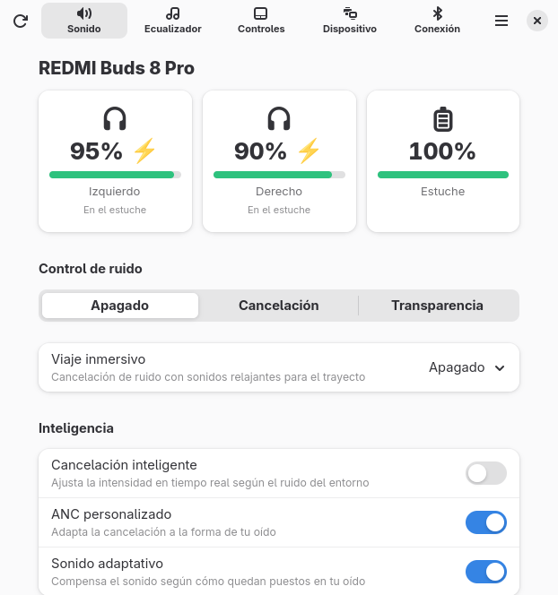
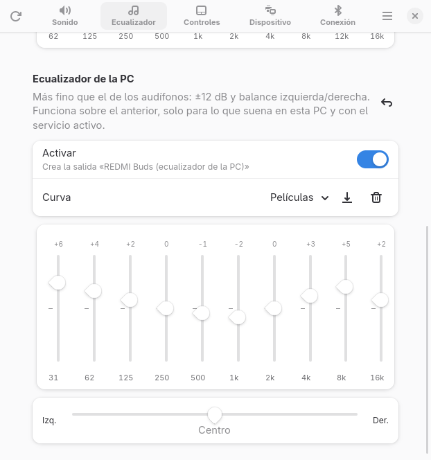
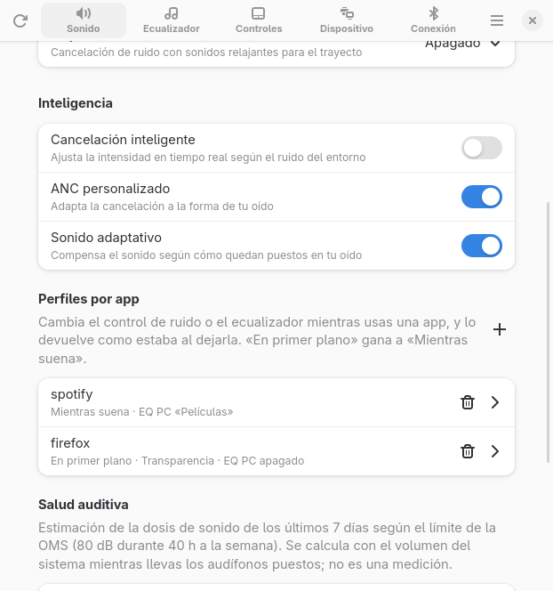
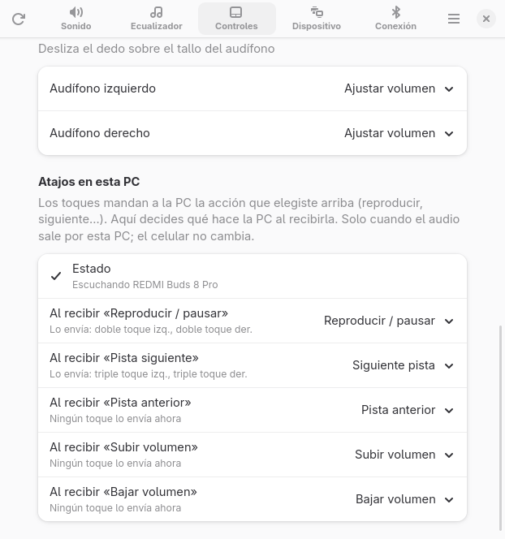
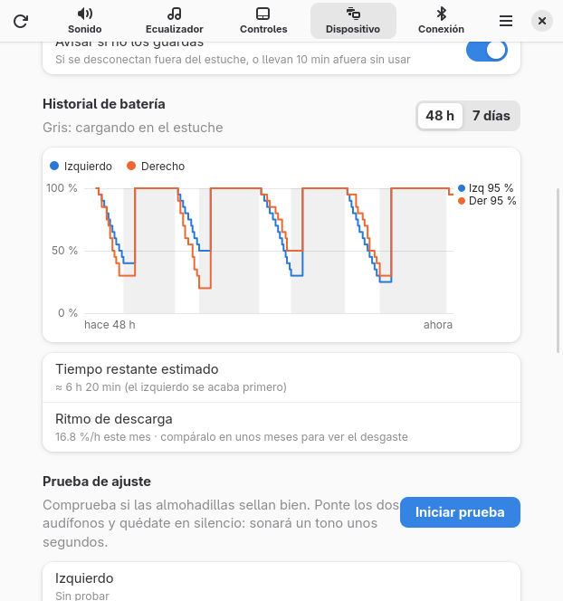

# Buds Manager

[English](README.md) · **Español**

| Sonido | Ecualizador de la PC | Perfiles por app | Atajos de gestos | Historial de batería* |
|---|---|---|---|---|
|  |  |  |  |  |

<sub>*Gráfica con datos de ejemplo.</sub>

Controla tus **REDMI Buds** desde Linux: cancelación de ruido, ecualizador, gestos, batería, prueba de
ajuste, buscar audífonos y más, con una app GTK4/libadwaita, un ícono en la bandeja, un CLI y un servicio
que automatiza cosas (pausa al quitártelos, perfiles por app, micrófono solo en llamadas con supresión de
ruido…). No existe la app oficial de Xiaomi para Linux; esta habla directamente con los audífonos.

Probado con **REDMI Buds 8 Pro** (firmware 3.2.2.6) en Arch Linux + Hyprland + PipeWire. Otros Redmi
Buds que use [Gadgetbridge](https://codeberg.org/Freeyourgadget/Gadgetbridge) probablemente funcionen
en lo básico (mismo protocolo), pero no están probados.

Usa el protocolo Xiaomi "MIWEAR" (RFCOMM canal 28, servicio `fd2d`), portado de Gadgetbridge.

## Instalación

Requisitos: Python 3, BlueZ (`bluez-utils`), PipeWire con `pipewire-pulse` y WirePlumber, y para la app
`python-gobject`, `gtk4` y `libadwaita`. Opcionales: `playerctl` (pausa automática, atajos) y
`noise-suppression-for-voice` (quitar ruido en llamadas).

```
git clone https://github.com/EchoStrokes08/Buds-Manager.git
cd Buds-Manager
./install.sh              # ./install.sh --uninstall para quitarlo
buds hold on              # opcional: el servicio mantiene el control en esta PC
```

El instalador enlaza `buds`, `buds-manager` y `buds-tray` en `~/.local/bin`, instala los servicios de
usuario de systemd y el lanzador, y la regla udev de los gestos (con `sudo`).

> No es un producto de Xiaomi ni está afiliado a Xiaomi. Úsalo bajo tu responsabilidad: escribe ajustes
> en los audífonos con el mismo protocolo que la app oficial, y `buds backup` / `buds restore` guardan y
> recuperan la configuración.

## Buds Manager (interfaz gráfica)

```
buds-manager
```

También aparece como **Buds Manager** en el lanzador de aplicaciones. GTK4 + libadwaita, cinco pestañas:

- **Sonido**: batería de cada auricular y del estuche, modo (apagado / cancelación / transparencia),
  intensidad de la cancelación o tipo de transparencia, ANC adaptativo, ANC personalizado, sonido adaptativo.
- **Ecualizador**: perfiles de fábrica y curva de 10 bandas (−6..+6 dB) con curvas rápidas.
- **Controles**: acción de 1, 2 y 3 toques y de mantener pulsado por auricular, y qué modos recorre.
- **Dispositivo**: detección de oído, respuesta automática, prueba de ajuste de almohadillas, buscar auriculares,
  modelo/firmware/número de serie, copias de seguridad y restaurar la configuración original.
- **Sonido** también incluye *Viaje inmersivo* (avión / transporte público / tren) y los niveles de
  cancelación del 8 Pro (ligera / profunda + cancelación inteligente).
- **Controles** incluye *Deslizar* (ajustar volumen / nada).
- **Conexión**: códec en esta PC (LDAC / AAC / llamadas con micrófono) y calidad LDAC (regla de WirePlumber), multipunto (escuchar en dos dispositivos) y gestor Bluetooth: buscar, emparejar,
  conectar, desconectar y olvidar dispositivos (BlueZ por D-Bus). También aparece si los audífonos no están conectados.

Las tarjetas de batería indican si cada audífono está en el oído, en el estuche o fuera.

Se actualiza sola cada 8 s con la ventana enfocada (45 s en segundo plano). Cada operación abre una sesión
corta, así que el CLI, Waybar y los atajos siguen funcionando con la ventana abierta.

## Uso del CLI

```
buds                         # estado completo
buds battery
buds mode [off|anc|transparency|next|toggle] [--notify]
buds strength anc light|deep
buds strength transparency regular|voice|ambient
buds adaptive-anc on|off
buds commute off|airplane|transit|train
buds gesture swipe left|right|both volume|none
buds personalized-anc on|off
buds eq [standard|voice|bass|treble|volume|custom|balanced]
buds eq-band 62 +4           # una banda (-6..+6), activa el preset custom
buds eq-curve 4 3 2 0 0 0 1 2 2 1
buds gesture single|double|triple|long left|right|both <acción>
buds cycle left|right|both anc-off|transparency-off|anc-transparency|all
buds ear-detection|auto-answer|multipoint|adaptive-sound on|off
buds find [left|right|both|stop]
buds backup [archivo] / buds restore [archivo]
buds status --raw --json     # bytes sin decodificar, para investigar
```

La configuración original está en `~/.local/state/redmi-buds/backup-initial.json`; `buds restore` la recupera.

## Ecualizador a tu oído

En la pestaña Ecualizador, «Ajustar a tu oído» abre una prueba de tonos: suena un tono de referencia
de 1 kHz y luego el de cada banda, y mueves la barra hasta que ambos suenen igual de fuerte. A esos
ajustes se les resta la curva de igual sonoridad ISO 226:2003 (60 fon), porque el oído es menos
sensible a los graves aunque los audífonos sean neutros; el resto se invierte, se centra en la
mediana y se limita a ±6 dB. La curva se guarda en los audífonos como perfil «Personalizado». Si
cierras la prueba sin guardar, se restaura el ecualizador anterior. Código: `hearing.py`,
`hearing_gui.py`.

## Automatizaciones (servicio en segundo plano)

Las ejecuta `buds-manager-daemon` mientras tiene el control (los avisos de batería también funcionan
cuando el celular tiene el control):

- **Pausa automática**: al quitarte un audífono se pausa lo que esté sonando en la PC (vía `playerctl`),
  solo si el audio sale por los audífonos. Al ponértelo de nuevo se reanuda únicamente lo que se pausó
  (si fue hace menos de 15 min).
- **Avisos de batería**: notificación al bajar a 20 % y a 10 % (crítica), y cuando terminan de cargar.
- **Salida automática**: al quitarte los dos audífonos el audio pasa a las bocinas de la PC; al ponerte
  uno vuelve a los audífonos (si no elegiste otra salida mientras tanto).
- **Sin ruido de fondo en llamadas** (`buds auto ruido on|off`): mientras una llamada usa el micrófono de
  los audífonos, el servicio arranca un filtro RNNoise de PipeWire y pasa la app al micrófono
  «Micrófono de los audífonos (sin ruido)»; se cierra al colgar. Requiere `noise-suppression-for-voice`.
- **¿Guardaste los audífonos?**: aviso si se desconectan de la PC estando afuera (ni puestos ni en el
  estuche), o si llevan 10 min afuera sin usar. Si te los llevas puestos no avisa.
- **Micrófono solo en llamadas** (`buds mic calls|any|never`, o en Conexión): usar el micrófono de unos
  audífonos Bluetooth baja la música a calidad de llamada. WirePlumber lo hacía con *cualquier* app que
  grabara, porque los audífonos eran el micrófono predeterminado. En modo `calls` el servicio apaga el
  cambio automático de WirePlumber, deja el micrófono de la PC como predeterminado y solo cambia al
  perfil de llamada cuando graba una app de llamadas (Discord, Zoom, Teams, Telegram, Signal, Slack,
  navegadores…; añade otras en `call_apps`). Mueve esa grabación al micrófono de los audífonos y, 3 s
  después de colgar, vuelve al códec de música que tenías. `any` = comportamiento de WirePlumber;
  `never` = nunca usar el micrófono de los audífonos.

```
buds auto                 # ver qué está activo
buds auto pausa off       # salida | pausa | reanudar | bateria | estuche | ruido  on|off
```

Se guarda en `~/.config/redmi-buds/config.json` (también `low_levels`, por defecto `[20, 10]`).

## Atajos en esta PC (gestos → acciones)

Los toques de los audífonos llegan a la PC como teclas multimedia (reproducir/pausar, siguiente,
anterior, subir/bajar volumen), según lo que tenga asignado cada toque. El servicio toma ese dispositivo
de entrada (`REDMI Buds 8 Pro (AVRCP)`) en exclusiva y ejecuta lo que elijas para cada tecla: la acción
normal, silenciar el micrófono, cambiar cancelación ↔ transparencia, captura de pantalla, nada o
cualquier comando. Solo actúa cuando el audio sale por esta PC; el celular no cambia.

Se configura en **Controles → Atajos en esta PC** o con:

```
buds atajos                                   # ver la tabla y si está escuchando
buds atajos previous mic-mute                 # triple toque «anterior» → silenciar micrófono
buds atajos next "cmd:hyprctl dispatch workspace +1"
buds atajos next next                         # volver a lo normal
```

Necesita el servicio activo (`buds hold on`) y la regla udev para leer `/dev/input` (la instala `install.sh`).

## Integración

- **Bandeja** (`buds-tray`, servicio `buds-tray.service` ligado a la sesión gráfica): ícono en cualquier
  bandeja StatusNotifierItem (Waybar, KDE…). Clic: abre Buds Manager. Menú: batería, modo de ruido,
  ecualizador y temporizador. Tooltip con modo, batería y tiempo restante.
- **Módulo propio para Waybar** (opcional), con `buds waybar` (JSON) y la señal 8 para refrescarlo:

  ```jsonc
  "custom/buds": {
      "exec": "~/.local/bin/buds waybar", "return-type": "json", "interval": 120, "signal": 8,
      "on-click": "~/.local/bin/buds mode next --notify",
      "on-click-middle": "~/.local/bin/buds-manager"
  }
  ```
- **Atajos de teclado** (ejemplo para Hyprland): `bind = SUPER, B, exec, ~/.local/bin/buds mode next --notify`.

## Más funciones del servicio

- **Temporizador para dormir** (`buds dormir 30|off`, o el menú de la bandeja): en los últimos minutos baja
  el volumen poco a poco, pausa y apaga la cancelación; luego restaura el volumen.
- **Rueda del mouse sobre el ícono de la bandeja**: cambia el modo de ruido.
- **Historial de batería** (Dispositivo): gráfica de 48 h / 7 días, tiempo restante estimado (también en el
  tooltip de la bandeja) y ritmo de descarga por mes para notar el desgaste. Se guarda en
  `~/.local/state/redmi-buds/battery.csv`.
- **Salud auditiva** (Sonido, `buds exposicion`): dosis de sonido de los últimos 7 días según la OMS
  (80 dB durante 40 h a la semana), con avisos al 80 % y 100 %. Es una **estimación** con el volumen del
  sistema; calíbrala con `ref_spl` en `config.json` (dB que alcanza la música al 100 %; 95 por defecto).
- **Ecualizador de la PC** (Ecualizador): 10 bandas de ±12 dB, preganancia automática y balance
  izquierda/derecha, con un filtro de PipeWire que crea la salida «REDMI Buds (ecualizador de la PC)».
  Solo en modo música; se detiene en llamadas y vuelve al colgar. Los cambios se aplican en vivo.
- **Buscar «frío o caliente»** (Dispositivo → Buscar audífonos): los hace sonar y muestra la intensidad de
  la señal Bluetooth para saber si te acercas. Leerla requiere root; `install.sh` agrega una regla de sudo
  que permite solo `btmgmt conn-info` (`71-redmi-buds-rssi.sudoers`).

## Perfiles por app

En **Sonido → Perfiles por app** (o `app_profiles` en `config.json`): cambia el control de ruido y/o el
ecualizador mientras usas una app, y al dejarla lo devuelve como estaba (salvo que lo hayas cambiado a mano).

- **En primer plano**: mientras su ventana está enfocada (clase de ventana de Hyprland; espera 1,5 s para
  no saltar con cada alt-tab).
- **Mientras suena**: mientras la app reproduce audio, aunque esté detrás (flujos de PipeWire).
- Si aplican los dos, gana el de primer plano. Lo ejecuta el servicio (`profiles.py`).

```json
"app_profiles": [
  {"app": "spotify", "when": "playing", "mode": null, "eq": "bass"},
  {"app": "zoom", "when": "focused", "mode": "transparency", "eq": "voice"}
]
```

## Protocolo descubierto con la captura de la app Xiaomi (2026-11-01)

| Config | Uso |
|---|---|
| `0x05` = 01 | inicia la prueba de ajuste; resultado por notificación de `0x06` (izq, der): 03 midiendo, 01 bien |
| `0x0c` | bits 0/1 izq/der en estuche, bits 2/3 izq/der en el oído |
| `0x28` | sincroniza la hora (timestamp Unix de 4 bytes) |
| `0x76` = 01 | la app lo envía al abrirse |
| `0x67` | viaje inmersivo: 0 off, 1 avión, 2 transporte, 3 tren |
| `0x1d` → `0x1e` | audio espacial: 02 off, 03 on, 0b on + seguimiento de cabeza. **Rechazado (estado 9) si no viene del celular**: el render lo hace el celular |
| `0x68` | motor espacial: 0 Xiaomi dimensional, 1 Dolby |
| `0x0b` (ANC) | 8 Pro: 01 ligera, 12 profunda (13 al entrar a ANC); `0x25` = cancelación inteligente |
| gesto `0x05` | deslizar: 0b volumen, 08 nada |
| `0x36` | [activo, nivel 1–5] del audio espacial (se activa con `0x1d`); inútil en la PC |
| `0x75`, `0x23`, `0x66` | sin identificar |

**Mantener el control en esta PC** (`buds hold on|off`, o el interruptor en la pestaña Conexión): activa
`buds-manager-daemon.service` (systemd de usuario), que toma el canal en cuanto los audífonos llegan a la PC,
reintenta cada segundo si el celular lo tiene y lo conserva aunque el celular se reconecte (probado). CLI, Waybar
y la app le hablan por `$XDG_RUNTIME_DIR/redmi-buds.sock`; los cambios hechos con gestos llegan al instante.
El celular sigue reproduciendo, pero su menú de los audífonos queda sin control.

Las lecturas piden varios ajustes por petición, como la app de Xiaomi (pedirlos uno a uno hacía que los
audífonos ignoraran los últimos).

**Límite de hardware:** el canal de control (RFCOMM 28) acepta un solo cliente. En un celular Xiaomi conectado,
el servicio `com.xiaomi.bluetooth` lo ocupa todo el tiempo, así que la PC no puede cambiar ajustes hasta que los
audífonos se desconecten del celular. El audio por multipunto no se ve afectado. El canal 17 es un servicio de información
básica sin autenticación que acepta varios clientes: al conectar envía tramas `03 <id> <len16> <dato>` con
id 01 = modelo (`11728a`), 02 = MAC, 03 = batería izq/der/estuche (mismo formato que GET_DEVICE_INFO).
El celular solo le manda `03 08 0002 0124`. Buds Manager lo usa para mostrar la batería cuando el celular
tiene el control.

## Pendiente

- Configs `0x75`, `0x23`, `0x66`: sin identificar.
- Modo juego: ni el menú de HyperOS ni la app Xiaomi Earbuds lo ofrecen para los 8 Pro (firmware
  3.2.2.6, revisado el 2026-11-03), así que probablemente no existe en este modelo.
- Renombrar los audífonos: ambos menús lo ofrecen; falta capturar si escribe el nombre en los audífonos o
  solo cambia el alias en el celular.
- LE Audio: el adaptador de la PC lo soporta (CIS/ISO), pero los 8 Pro (firmware 3.2.2.6) no anuncian
  servicios LE Audio (sin `184e`/`1850`/`1853` en un escaneo LE, 2026-11-03).

## Pruebas

```
python3 -m unittest discover -s tests
```

Solo usan la biblioteca estándar y carpetas temporales (no tocan tu configuración). Cubren la
decodificación del protocolo, perfiles por app, temporizador, salida automática, avisos de estuche,
historial de batería, exposición, ecualizador de la PC y detección de llamadas. Corren en GitHub Actions
con cada push.

## Licencia

[AGPL-3.0-or-later](LICENSE), como Gadgetbridge, del que se portó el protocolo.
