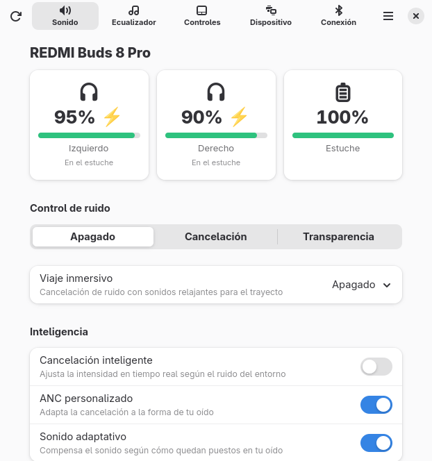
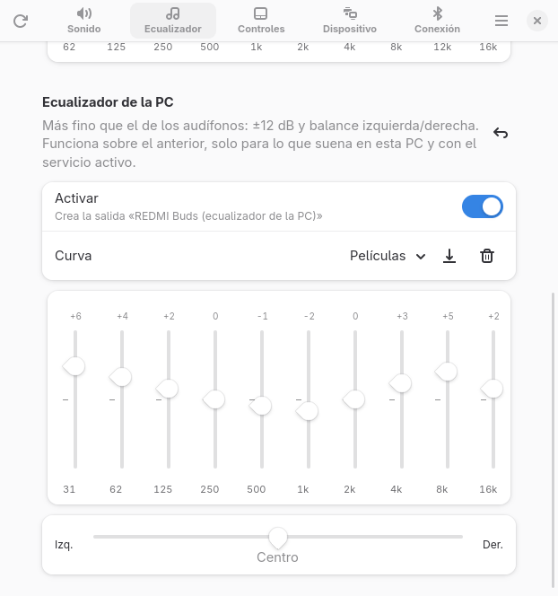
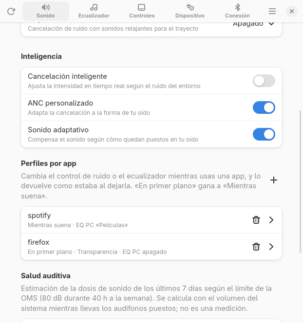
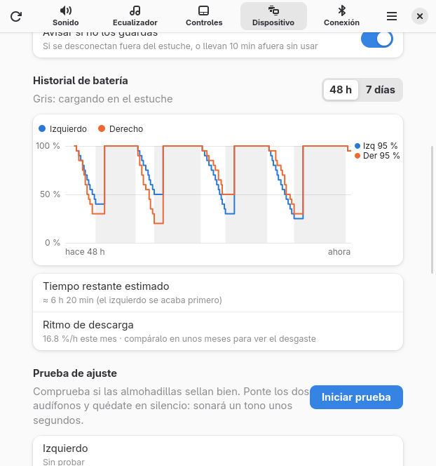

# Buds Manager

**English** · [Español](README.es.md)

Control your **REDMI Buds** from Linux: noise cancelling, equalizer, gestures, battery, fit test, find my
earbuds and more — with a GTK4/libadwaita app, a tray icon, a CLI and a background service that automates
things (pause when you take them out, per-app profiles, mic only for calls with noise suppression…).
Xiaomi has no official app for Linux; this one talks to the earbuds directly.

| Sound | PC equalizer | Per-app profiles | Gesture shortcuts | Battery history* |
|---|---|---|---|---|
|  |  |  |  |  |

<sub>The interface is in Spanish for now. *Chart with sample data.</sub>

Tested with **REDMI Buds 8 Pro** (firmware 3.2.2.6) on Arch Linux + Hyprland + PipeWire. Other Redmi Buds
supported by [Gadgetbridge](https://codeberg.org/Freeyourgadget/Gadgetbridge) will probably work for the
basics (same protocol), but are untested.

It speaks Xiaomi's "MIWEAR" protocol (RFCOMM channel 28, service `fd2d`), ported from Gadgetbridge.

## Install

Requirements: Python 3, BlueZ (`bluez-utils`), PipeWire with `pipewire-pulse` and WirePlumber, and for the
app `python-gobject`, `gtk4` and `libadwaita`. Optional: `playerctl` (auto-pause, shortcuts) and
`noise-suppression-for-voice` (noise suppression in calls).

```
git clone https://github.com/EchoStrokes08/Buds-Manager.git
cd Buds-Manager
./install.sh              # ./install.sh --uninstall to remove it
buds hold on              # optional: the service keeps control of the earbuds on this PC
```

The installer links `buds`, `buds-manager` and `buds-tray` into `~/.local/bin`, installs the systemd user
services and the launcher, a udev rule for gesture shortcuts and a sudo rule that only allows reading the
Bluetooth signal strength (`btmgmt conn-info`, for the "hot or cold" finder).

> Not a Xiaomi product nor affiliated with Xiaomi. Use at your own risk: it writes settings to the earbuds
> with the same protocol as the official app; `buds backup` / `buds restore` save and restore them.

## What it does

**On the earbuds** (app tabs *Sound*, *Equalizer*, *Controls*, *Device*):
- Battery of each earbud and the case, in-ear / in-case / out status.
- Noise control: off / ANC (light, deep, smart) / transparency (regular, voice, ambient), adaptive and
  personalized ANC, adaptive sound, *immersive commute* (plane / transit / train).
- Factory EQ presets and a custom 10-band curve (±6 dB), plus a **hearing test** that builds a curve for
  your ears (equal-loudness compensated, ISO 226).
- Gestures: single/double/triple tap, long press (and which modes it cycles), swipe.
- Ear detection, auto-answer, multipoint, fit test, find earbuds, model/firmware/serial, backups.

**On the PC** (needs the service, `buds hold on`):
- **Gesture shortcuts**: the earbuds' taps arrive as media keys; choose what the PC does with each one
  (mic mute, ANC ↔ transparency, screenshot, any command).
- **Auto-pause / resume** when you take an earbud out, and **audio output follows the earbuds** (both out →
  PC speakers, back in → earbuds).
- **Mic only for calls**: Bluetooth earbuds drop to call quality when their mic is used. The service only
  switches for call apps (Discord, Zoom, Teams, Telegram, browsers…), moves the call to the earbuds' mic,
  adds **RNNoise noise suppression**, and goes back to LDAC/AAC when you hang up.
- **Per-app profiles**: noise mode, earbud EQ and PC EQ curve while an app is focused or playing; restored
  when you leave it (unless you changed it by hand).
- **PC equalizer**: 10 bands of ±12 dB, automatic pre-gain and left/right balance (PipeWire filter-chain),
  with named curves; only in music mode.
- **Battery history** with a time-left estimate and the monthly discharge rate (to notice wear).
- **Hearing health**: estimated weekly sound dose against the WHO limit (80 dB for 40 h a week), with
  alerts at 80 % and 100 %. It's an estimate from the system volume; calibrate `ref_spl` in `config.json`.
- **Sleep timer** (fade out, pause, ANC off), **"did you put them away?"** alerts, low-battery and
  fully-charged notifications, **"hot or cold" finder** (Bluetooth signal strength while they beep).
- **Codec** (LDAC / AAC / calls) and LDAC quality, Bluetooth device manager.
- **Tray icon** (StatusNotifierItem: Waybar, KDE…): battery, mode, EQ, sleep timer; scroll to change mode.
- **Waybar**: an icon and a percentage for each earbud and the case (`buds waybar --part left|right|case`,
  `--icon` for an image module); see the Spanish README for a config example.
- **Looks**: dark Ayu theme by default (or your system theme), with illustrations of the earbuds and case in
  their real color — Obsidian Black, Cloud White or Glacier Blue (menu → *Color de los audífonos*).

## CLI

```
buds                         # full status
buds battery
buds mode [off|anc|transparency|next|toggle|flip] [--notify]
buds strength anc light|deep
buds strength transparency regular|voice|ambient
buds eq [standard|voice|bass|treble|volume|custom|balanced]
buds eq-band 62 +4           # one band (-6..+6), switches to the custom preset
buds gesture single|double|triple|long|swipe left|right|both <action>
buds commute off|airplane|transit|train
buds ear-detection|auto-answer|multipoint|adaptive-sound|adaptive-anc|personalized-anc on|off
buds find [left|right|both|stop]
buds backup [file] / buds restore [file]
buds hold on|off|status      # keep the earbuds' control channel on this PC
buds auto [salida|pausa|reanudar|bateria|estuche|ruido] [on|off]
buds mic calls|any|never     # when to use the earbuds' microphone
buds atajos [key] [action]   # gesture shortcuts on the PC
buds dormir 30|off           # sleep timer
buds exposicion              # weekly sound dose
buds status --raw --json     # undecoded bytes, for protocol research
```

Settings live in `~/.config/redmi-buds/config.json`; history and backups in `~/.local/state/redmi-buds/`.

## How it works (and its limits)

- The control channel (RFCOMM 28) accepts **one client**. A connected Xiaomi phone (`com.xiaomi.bluetooth`)
  grabs it and never lets go, so the PC can't change settings while the phone holds it. With `buds hold on`
  a service takes the channel as soon as the earbuds reach the PC and keeps it; the phone keeps playing
  audio, but its earbuds menu loses control. Channel 17 is an unauthenticated info service that gives the
  battery even while the phone holds channel 28.
- Spatial audio can't be enabled from the PC: the earbuds reject it unless it comes from the phone, which
  renders it.
- LE Audio: the PC adapter may support it, but the 8 Pro (firmware 3.2.2.6) advertise no LE Audio services.

The protocol notes (config IDs decoded from Xiaomi app captures) are in the [Spanish README](README.es.md).

## Tests

```
python3 -m unittest discover -s tests
```

Standard library only, temporary directories (your config is never touched). They run on GitHub Actions on
every push.

## License

[AGPL-3.0-or-later](LICENSE), like Gadgetbridge, from which the protocol was ported.
